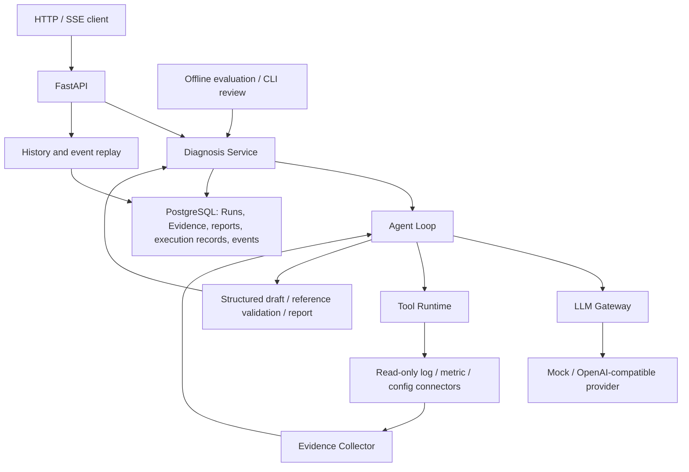

# EvidenceOps

<p align="center"><strong>Evidence-backed diagnosis for software incidents</strong></p>
<p align="center">
<a href="README.zh-CN.md">简体中文</a> · <a href="#quick-start">Quick start</a> · <a href="#architecture">Architecture</a> · <a href="#http-api">API</a> · <a href="#evaluation">Evaluation</a>
</p>

EvidenceOps is a backend diagnostic Agent that combines model reasoning with controlled, read-only evidence collection. Structured reports reference evidence from the same Run; execution records and durable lifecycle events support inspection and replay.

The product direction is diagnosis across common programming languages and backend stacks. The current API accepts an incident description and queries local JSONL logs, metrics, and historical configuration. File uploads, language-specific automatic parsing, and RAG retrieval are not implemented. The included order-service RPC scenario is a reproducible example, not a restriction on the intended audience.

## Capabilities

| Capability | Behavior |
| --- | --- |
| Orchestration | Provider-independent Agent Loop, OpenAI-compatible adapter, deterministic Mock |
| Controlled tools | Read-only registration, argument validation, bounded concurrency, call correlation |
| Evidence-backed reports | Source, observation time, location, version, content hash, reference validation |
| Durable history | PostgreSQL storage for Runs, Evidence, reports, execution records, and events |
| Streaming and replay | SSE lifecycle events and cursor replay without re-executing the diagnosis |
| Execution control | Shared budget, individual timeouts, and cooperative cancellation |
| Startup reconciliation | Single-instance lock; orphaned Runs atomically fail with a terminal event |
| Evaluation | 20-case offline suite, automated rules, resumable CLI human review |

Reference validation verifies evidence ownership and existence, not whether the evidence semantically proves a claim. Semantic quality is evaluated separately.

## Architecture



The model proposes tool calls; Tool Runtime validates and executes them. The application layer owns lifecycle, budgets, cancellation, and report construction. Infrastructure supplies database and model adapters.

| Directory | Responsibility |
| --- | --- |
| `src/evidenceops/domain/` | Run lifecycle, Evidence and report invariants |
| `src/evidenceops/application/` | Orchestration, contracts, collection, history, reconciliation |
| `src/evidenceops/infrastructure/` | SQLAlchemy repositories and model providers |
| `src/evidenceops/connectors/` | Local read-only data sources |
| `src/evidenceops/api/` | HTTP endpoints and SSE transport |
| `src/evidenceops/evaluation/` | Offline checks and review CLI |
| `alembic/`, `tests/`, `samples/` | Migrations, regression tests, reproducible fixtures |

## Quick start

Requires Python 3.14 and PowerShell. PostgreSQL mode also requires Docker Compose. Run commands from the repository root. The API runs on the host; Compose runs PostgreSQL only.

### Install and run locally

The repository currently has no dependency manifest or lockfile. Install runtime and test dependencies explicitly:

```powershell
python -m venv .venv
.\.venv\Scripts\python.exe -m pip install fastapi uvicorn httpx pydantic sqlalchemy alembic "psycopg[binary]" pytest
$env:PYTHONPATH=(Join-Path $PWD.Path 'src')
$env:EVIDENCEOPS_PROVIDER='mock'
$env:EVIDENCEOPS_PERSISTENCE='memory'
.\.venv\Scripts\python.exe -m uvicorn evidenceops.api.agent_app:app --host 127.0.0.1 --port 8000
```

Open [API documentation](http://127.0.0.1:8000/docs). This mode needs no database or model credentials; persisted history and replay are unavailable.

### Enable PostgreSQL

Stop the API before changing modes. Create a local, untracked `.env` containing `POSTGRES_PASSWORD=<your-local-password>`. Compose reads that file; Python reads environment variables.

```powershell
$env:POSTGRES_PASSWORD=((Get-Content .env | Where-Object { $_ -match '^POSTGRES_PASSWORD=' } | Select-Object -First 1) -replace '^POSTGRES_PASSWORD=','')
docker compose up -d postgres
docker compose ps
$env:EVIDENCEOPS_PERSISTENCE='postgres'
.\.venv\Scripts\python.exe -m alembic upgrade head
.\.venv\Scripts\python.exe -m uvicorn evidenceops.api.agent_app:app --host 127.0.0.1 --port 8000
```

Wait for PostgreSQL to become healthy before migrating. The host connects to `127.0.0.1:5433`; the container listens on `5432`. The named volume retains database files across container replacement. Deleting it deletes the data. Changing the initialization password later does not change the existing database role password. Schema migration is explicit, not performed at API startup.

### Configure a real model

Set these variables in the API shell, then restart the service:

```powershell
$env:EVIDENCEOPS_PROVIDER='openai-compatible'
$env:EVIDENCEOPS_MODEL_BASE_URL='https://your-provider.example/compatible-mode/v1'
$env:EVIDENCEOPS_MODEL_NAME='your-tool-capable-model'
$model_secret=Read-Host 'Model API key' -AsSecureString
$env:EVIDENCEOPS_MODEL_API_KEY=[System.Net.NetworkCredential]::new('', $model_secret).Password
Remove-Variable model_secret
$env:EVIDENCEOPS_MODEL_TIMEOUT_SECONDS='120'
$env:EVIDENCEOPS_RUN_TIMEOUT_SECONDS='180'
```

Replace the URL/model with provider configuration. The adapter uses Chat Completions tool calls and JSON-object output; compatibility naming alone does not guarantee support. Real requests incur provider charges.

## Configuration

| Variable | Default | Purpose |
| --- | --- | --- |
| `EVIDENCEOPS_PROVIDER` | `mock` | `mock` or `openai-compatible` |
| `EVIDENCEOPS_PERSISTENCE` | `memory` | `memory` or `postgres` |
| `EVIDENCEOPS_MODEL_BASE_URL` | — | Provider base URL |
| `EVIDENCEOPS_MODEL_API_KEY` | — | Provider credential |
| `EVIDENCEOPS_MODEL_NAME` | — | Provider model |
| `EVIDENCEOPS_MODEL_TIMEOUT_SECONDS` | `60` | Individual real-model timeout |
| `EVIDENCEOPS_RUN_TIMEOUT_SECONDS` | `180` | API diagnosis budget |
| `POSTGRES_HOST` / `POSTGRES_PORT` | `127.0.0.1` / `5433` | Host database endpoint |
| `POSTGRES_DB` / `POSTGRES_USER` | `evidenceops` / `evidenceops` | Database and role |
| `POSTGRES_PASSWORD` | — | Required for PostgreSQL mode |

Restart after changing environment variables. API budgets do not automatically apply to direct assembly or offline Eval callers.

## HTTP API

| Method | Endpoint | Purpose |
| --- | --- | --- |
| POST | `/api/v1/agent/diagnosis` | Create a diagnosis and return its result |
| POST | `/api/v1/agent/diagnosis/stream` | Create a diagnosis and stream lifecycle events |
| GET | `/api/v1/agent/runs/{run_id}` | Read persisted status and artifacts |
| GET | `/api/v1/agent/runs/{run_id}/events` | Read ordered event pages |
| GET | `/api/v1/agent/runs/{run_id}/events/stream` | Replay and observe an existing Run |
| POST | `/api/v1/agent/runs/{run_id}/cancel` | Request cancellation |

Send the included request from another shell:

```powershell
curl.exe -N -X POST "http://127.0.0.1:8000/api/v1/agent/diagnosis/stream" -H "Content-Type: application/json" --data-binary "@samples/requests/sse-diagnosis.json"
```

Results include IDs, status, timestamps, error code, Evidence, report, and execution records. Synchronous failed diagnoses currently return HTTP 503; history can return HTTP 200 with `status=failed`. HTTP and diagnostic success are separate.

SSE publishes Run, model, and tool lifecycle events, optional cancellation requests, and a terminal `run_completed`, `run_failed`, or `run_cancelled`. It streams execution events, not model tokens.

```powershell
$run_id=(Read-Host 'Run ID').Trim()
curl.exe "http://127.0.0.1:8000/api/v1/agent/runs/$run_id"
curl.exe "http://127.0.0.1:8000/api/v1/agent/runs/$run_id/events?after=0&limit=100"
curl.exe -N "http://127.0.0.1:8000/api/v1/agent/runs/$run_id/events/stream?after=2"
curl.exe -i -X POST "http://127.0.0.1:8000/api/v1/agent/runs/$run_id/cancel"
```

Replay starts strictly after the cursor. Alternatively send `Last-Event-ID: <run_id>:2`; header and query cursors must agree if both supplied. Pages expose `events`, `next_sequence`, `max_sequence`, `has_more`, and `status`, with limits of 1–1000. GET does not create a diagnosis. Clients retain complete event IDs and deduplicate; browser EventSource clients should close on terminal events.

Cancellation HTTP 202 acknowledges a request, not a committed terminal state. Repeated requests are idempotent; finalization conflicts return 409. A cancelled Run has `status=cancelled`, `error_code=null`, and no report.

## Reliability and operating limits

- **Persistence:** business events commit before delivery. Final Run state, artifacts, and terminal event commit atomically. Transport failure does not undo commits; transport-only `stream_failed` has no durable SSE ID.
- **Replay:** history and new events share a database cursor. Short sessions close before delivery/waiting. Poll interval is 0.5 seconds; heartbeats are 15 seconds.
- **Capacity:** four POST streaming diagnoses and sixteen GET observation connections per process, with separate admission limits. These are not a global limit for synchronous POST requests.
- **Execution control:** cooperative checks reject late results. Commits, cleanup, and non-cooperative threads can exceed the budget. Local model cancellation does not guarantee upstream generation/billing stops.
- **Startup:** one PostgreSQL API instance per database holds a session advisory lock. Orphaned `pending/running` Runs atomically become `failed / RUN_INTERRUPTED` with a terminal event; repeated startup is idempotent. Agent execution is not resumed.
- **Crash boundary:** committed artifacts survive. Complete Evidence and execution records are primarily archived at finalization, so events can survive while corresponding artifacts remain absent.
- **Deployment scope:** one worker, lifespan enabled. Authentication, tenant isolation, distributed coordination, event retention, automated backups, and production log-platform connectors are not implemented. This is a diagnostic backend foundation, not a complete production operations platform.

History/replay require PostgreSQL. Typical replay errors: `RUN_NOT_FOUND` (404), invalid/conflicting cursors (422), `INVALID_EVENT_CURSOR` or `EVENT_HISTORY_GAP` (409), `REPLAY_BUSY` (429). Model protocol failures and tool rejection remain explicit diagnosis results.

## Evaluation

The 20-case suite reuses the diagnostic runtime without HTTP/PostgreSQL. Automated rules inspect tool arguments, expected outcomes, evidence, and references. CLI review evaluates report meaning.

```powershell
.\.venv\Scripts\python.exe -X utf8 -m evidenceops.evaluation --mode mock --output eval_result_mock.json
.\.venv\Scripts\python.exe -X utf8 -m evidenceops.evaluation review eval_result_mock.json
```

Use `--mode real` with provider variables configured for real-model evaluation. Review accepts y/n and an optional comment, saves each decision, and resumes pending cases.

| Metric | Definition |
| --- | --- |
| `rule_pass_rate` | Rule-passed cases / all cases |
| `semantic_pass_rate` | Human-approved cases / all cases |
| `final_pass_rate` | Cases passing both / all cases |

Pending reviews and exceptions remain in the denominator. Correctly rejected invalid requests can pass. Mock results verify engineering behavior, not real-model accuracy.

## Testing

```powershell
$env:PYTHONPATH=(Join-Path $PWD.Path 'src')
.\.venv\Scripts\python.exe -X utf8 -m pytest -q -p no:cacheprovider
```

Coverage includes domain rules, tools, providers, persistence, evaluation, streaming, budgets, cancellation, replay, and startup reconciliation. PostgreSQL tests are opt-in: configure database variables and set `EVIDENCEOPS_TEST_POSTGRES='1'` before pytest, then remove it afterward. They use isolated schemas and test lock keys. Real-provider acceptance is separate from deterministic regression.

## Extension direction

Planned additions include RAG ingestion/retrieval, language/framework input adapters, and evaluated integrations with LangChain, LangGraph, MCP, and OpenTelemetry. They are not current dependencies or implemented capabilities.

## Contributing

Keep domain rules separate from model/database adapters. Include relevant failure-path tests and matching API/configuration documentation. Do not commit credentials or generated evaluation artifacts. Dependency pinning and license selection remain maintenance tasks; the repository currently declares no license.
