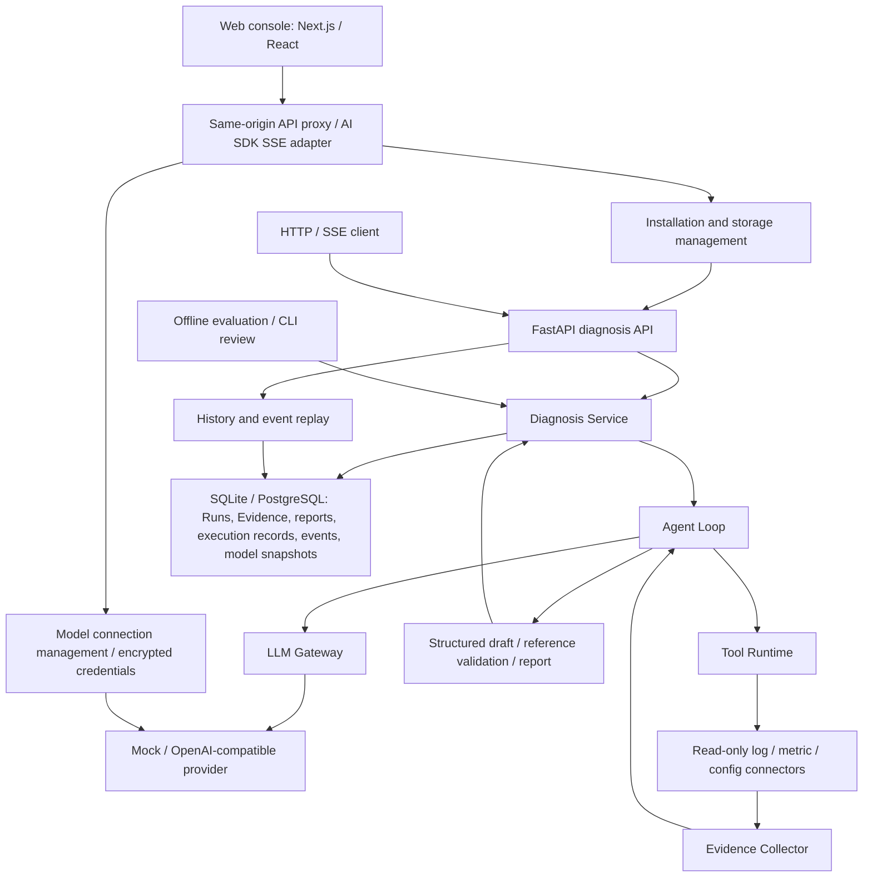

# EvidenceOps

<p align="center"><strong>Evidence-backed diagnosis for software incidents</strong></p>
<p align="center">
<a href="README.zh-CN.md">简体中文</a> · <a href="#quick-start">Quick start</a> · <a href="#architecture">Architecture</a> · <a href="#http-api">API</a> · <a href="#evaluation">Evaluation</a>
</p>

EvidenceOps is a local incident diagnosis application with a web console and a diagnostic Agent. It combines model reasoning with controlled, read-only evidence collection. Structured reports reference evidence from the same Run; execution records and durable lifecycle events support inspection and replay.

The web console accepts incident descriptions and imports text files locally into the input. The backend queries local JSONL logs, metrics, and historical configuration. Importing a file does not configure a data source or upload a log archive. The included order-service RPC scenario uses repository samples; customer data-source setup, language-specific automatic parsing, and RAG retrieval are not implemented.

## Capabilities

| Capability | Behavior |
| --- | --- |
| Orchestration | Provider-independent Agent Loop, OpenAI-compatible adapter, deterministic Mock |
| Controlled tools | Read-only registration, argument validation, bounded concurrency, call correlation |
| Evidence-backed reports | Source, observation time, location, version, content hash, reference validation |
| Web console | Diagnosis workspace, searchable history, evidence drawer, execution timeline, offline evaluation viewer |
| Model connections | Encrypted credentials, model catalogs, explicit capability validation, defaults and per-Run selection |
| Durable history | Installed mode uses SQLite by default; PostgreSQL is available for managed storage |
| Installation and storage | First-run setup, connection checks, storage switching, logical backup import/export and restore |
| Streaming and replay | SSE lifecycle events and cursor replay without re-executing the diagnosis |
| Execution control | Shared budget, individual timeouts, and cooperative cancellation |
| Startup reconciliation | Single-instance lock; orphaned Runs atomically fail with a terminal event |
| Evaluation | 20-case offline suite, automated rules, resumable CLI human review |

Reference validation verifies evidence ownership and existence, not whether the evidence semantically proves a claim. Semantic quality is evaluated separately.

## Architecture



The model proposes tool calls; Tool Runtime validates and executes them. The application layer owns lifecycle, budgets, cancellation, and report construction. Infrastructure supplies database and model adapters.

| Directory | Responsibility |
| --- | --- |
| `src/evidenceops/domain/` | Run lifecycle, Evidence and report invariants |
| `src/evidenceops/application/` | Orchestration, contracts, collection, history, reconciliation |
| `src/evidenceops/infrastructure/` | SQLAlchemy repositories and model providers |
| `src/evidenceops/connectors/` | Local read-only data sources |
| `src/evidenceops/api/` | HTTP endpoints and SSE transport |
| `src/evidenceops/evaluation/` | Offline checks and review CLI |
| `frontend/src/components/` | Diagnosis, history, evaluation, model connections and storage pages |
| `frontend/src/lib/`, `frontend/src/app/api/` | Typed contracts, Run state, SSE parsing and controlled same-origin proxy |
| `scripts/` | Local service launcher |
| `alembic/`, `tests/`, `samples/` | Migrations, regression tests, reproducible fixtures |

## Quick start

The verified Python environment is 3.14. The web console requires Node.js 20.9 or later; the local launcher requires PowerShell 7. Run commands from the repository root. Docker Compose is optional for the included PostgreSQL service; SQLite requires no separately installed database.

### Start the complete application (recommended)

**Use this entry point to start both the web console and the backend.** After downloading the repository, install dependencies and build the frontend from the repository root:

```powershell
python -m venv .venv
.venv/Scripts/python.exe -m pip install -r requirements.txt
cd frontend
npm.cmd ci
npm.cmd run build
cd ..
pwsh -File scripts/start_installed.ps1
```

Open [EvidenceOps](http://127.0.0.1:3013). The launcher runs the installed API on `8014` and the web console on `3013`, sharing a data directory and a server-side management token. A fresh installation defaults to SQLite and Mock. First-run setup checks storage, model configuration and the sample data-source boundary.

Once dependencies and the build are ready, subsequent starts require only this command from the repository root:

```powershell
pwsh -File scripts/start_installed.ps1
```

Keep this terminal running. Press `Ctrl+C` to stop both services; closing the terminal ends web access, and the launcher does not configure startup at login. Run the same command to start again. Reusing the data directory preserves history and configuration. After frontend source updates, stop the services, rerun `npm.cmd ci` and `npm.cmd run build` in `frontend`, then start the launcher again.

| Service | Default address | Purpose |
| --- | --- | --- |
| Web console | `http://127.0.0.1:3013` | User-facing entry point |
| Installed API | `http://127.0.0.1:8014` | Web backend and storage management |

The launcher sets the web proxy target and data directory. No separate `npm run start` or manual frontend proxy change is required. The development API commands below start only the backend, without the web console.

| Startup issue | Action |
| --- | --- |
| `pwsh` not found | Install PowerShell 7 and reopen the terminal |
| `node` or `npm.cmd` not found | Install a compatible Node.js version and reopen the terminal |
| Missing dependencies or frontend build | Complete the installation commands above and confirm `npm.cmd run build` succeeds |
| Port already in use | Stop the existing instance, or choose different `-ApiPort` and `-WebPort` values and open the new web port |
| Browser reports connection refused | Check that the launcher terminal is still running; if it exited, inspect its error output and restart |

Use `-DataDirectory D:/EvidenceOpsData -ApiPort 8014 -WebPort 3013` to change the launcher settings. This is a source-based installation, not a packaged installer. See [local installation and storage](CUSTOMER_INSTALLATION.md) for migration and backup details.

### Run the development API separately

The development API retains explicit memory/PostgreSQL modes and does not expose installation storage management. Runtime dependencies are pinned in `requirements.txt`; test dependencies are in `requirements-dev.txt`.

```powershell
.venv/Scripts/python.exe -m pip install -r requirements-dev.txt
$env:PYTHONPATH=(Join-Path $PWD.Path 'src')
$env:EVIDENCEOPS_PROVIDER='mock'
$env:EVIDENCEOPS_PERSISTENCE='memory'
.\.venv\Scripts\python.exe -m uvicorn evidenceops.api.agent_app:app --host 127.0.0.1 --port 8000
```

Open [API documentation](http://127.0.0.1:8000/docs). This mode needs no database or model credentials; persisted history and replay are unavailable.

For separate frontend development, run `npm ci` in `frontend`, set `EVIDENCEOPS_API_URL` to this API in the frontend shell, then run `npm run dev`. The default web port is `3000`. Use the installed API when developing storage management. The proxy target is server-side configuration, never a browser-supplied URL.

### Enable PostgreSQL for the development API

Stop the API before changing modes. Create a local, untracked `.env` containing `POSTGRES_PASSWORD=<your-local-password>`. Compose reads that file; Python reads environment variables.

```powershell
$env:POSTGRES_PASSWORD=((Get-Content .env | Where-Object { $_ -match '^POSTGRES_PASSWORD=' } | Select-Object -First 1) -replace '^POSTGRES_PASSWORD=','')
docker compose up -d postgres
docker compose ps
$env:EVIDENCEOPS_PERSISTENCE='postgres'
.\.venv\Scripts\python.exe -m alembic upgrade head
.\.venv\Scripts\python.exe -m uvicorn evidenceops.api.agent_app:app --host 127.0.0.1 --port 8000
```

Wait for PostgreSQL to become healthy before migrating. The host connects to `127.0.0.1:5433`; the container listens on `5432`. The named volume retains database files across container replacement. Deleting it deletes the data. Changing the initialization password later does not change the existing database role password. The development API requires explicit migration; the installed application manages SQLite migrations and offers confirmed PostgreSQL initialization/upgrades in its storage page.

### Configure a real model

In the web console, use **Settings → Model connections** to save and validate a user connection, then select it near the diagnosis input. Alternatively, set these variables in the API shell and restart to provide a read-only system connection:

```powershell
$env:EVIDENCEOPS_PROVIDER='openai-compatible'
$env:EVIDENCEOPS_MODEL_BASE_URL='https://your-provider.example/compatible-mode/v1'
$env:EVIDENCEOPS_MODEL_NAME='your-tool-capable-model'
$model_secret=Read-Host 'Model API key' -AsSecureString
$env:EVIDENCEOPS_MODEL_API_KEY=[System.Net.NetworkCredential]::new('', $model_secret).Password
Remove-Variable model_secret
$env:EVIDENCEOPS_MODEL_TIMEOUT_SECONDS='120'
$env:EVIDENCEOPS_RUN_TIMEOUT_SECONDS='180'
```

Replace the URL/model with provider configuration. The adapter uses Chat Completions tool calls and JSON-object output; compatibility naming alone does not guarantee support. Real requests incur provider charges.

## Web console

The frontend uses Next.js 16 App Router, React 19, TypeScript, AI SDK 6, assistant-ui, Radix Dialog and Tailwind CSS 4. Its five pages use a graphite sidebar, neutral workspace, compact forms and status colors tied to actual outcomes.

| Page | Responsibilities |
| --- | --- |
| Diagnosis workspace | Text input/local text import, per-Run model selection, streaming timeline, cancellation, report and clickable evidence references |
| Run history | Server-side search, status filtering, pagination, Run ID lookup and URL-based reload |
| Evaluation results | Read-only local import of schema-version-1 JSON, validated statistics, rule checks and human-review status |
| Model connections | Add/edit/delete, credential replacement, model catalogs, explicit validation and independent global defaults |
| Data and storage | First-run setup, actual storage state, database checks, maintenance progress, backups and restore |

The browser sends provider traffic through the controlled backend. Credentials are submitted only when creating or replacing them; reads do not return API keys. Keys do not enter browser persistent storage, URLs or logs. Model catalogs, recommendations and manually entered IDs do not imply account access or Agent readiness. Validation separately checks authentication, model calls, tool/result correlation and structured reports, and may incur provider charges.

Per-Run selection does not change the global default. Each Run records its connection name, provider, requested/actual model and configuration version; later connection edits or deletion do not rewrite history. Older Runs without model information display “Not recorded.” Embedding and Rerank are separate concerns; selecting a diagnosis model does not reconfigure them or rebuild an index.

`POST /api/diagnosis` adapts AI SDK messages to one backend diagnosis. Once a Run ID is known, interrupted observation retries GET with bounded backoff, without repeating creation. Events are deduplicated by Run ID and sequence; gaps and cross-Run data are rejected. Transport failure and business failure are separate states. Closing an observation connection does not cancel the backend Run; cancellation requires an explicit request.

Evidence views expose the saved summary, location, time, version and hash, not original log files. Offline evaluation imports stay in the browser and do not start online evaluation. See the [model connection API contract](frontend/MODEL_CONNECTIONS_CONTRACT.md).

The UI, proxy and backend validate input structure: blank, punctuation-only, symbol-only and over-100000-character descriptions are rejected; short error codes and multilingual logs are accepted. Character checks cannot establish meaningful fault context. Mock uses fixed tool calls and reports without interpreting input. Reports use the Run snapshot to display a Mock demo label and sample confidence. Mock can still run from the workbench; a separate demo entry point is not implemented.

### Frontend development and file responsibilities

| Directory | Responsibility |
| --- | --- |
| `frontend/src/components/` | Workbench, history, evaluation, connections and storage pages |
| `frontend/src/lib/` | Contracts, event parsing, Run state, evidence numbering and API clients |
| `frontend/src/app/api/diagnosis/` | AI SDK message and backend SSE adaptation |
| `frontend/src/app/api/backend/` | Fixed target, route allowlist and management-token forwarding |
| `frontend/src/app/globals.css` | Styles, states, focus and responsive layouts |
| `frontend/tests/` | Unit tests, isolated backend and Playwright CLI scenarios |

For frontend-only development, start FastAPI as described above, then run in another terminal:

```powershell
cd frontend
npm.cmd ci
$env:EVIDENCEOPS_API_URL='http://127.0.0.1:8000'
npm.cmd run dev
```

The development web port defaults to 3000; `npm.cmd run start -- --port 3013` specifies a production port. When starting installed services separately, both must share `EVIDENCEOPS_DATA_DIR`; the Next.js server reads the management token from it. Prefer the root launcher for the complete application to keep configuration consistent.

## Data and storage

Installed mode separates application files from persistent data. Windows defaults to `%LOCALAPPDATA%/EvidenceOps`; other platforms use `$XDG_DATA_HOME/evidenceops` or `~/.local/share/evidenceops`. The directory is resolved on the running host and may be overridden with `EVIDENCEOPS_DATA_DIR`.

Runs, reports, evidence summaries, execution records, events and model snapshots are stored in the selected diagnosis database. Model connections use a separate encrypted configuration store. SQLite starts without an external database. PostgreSQL requires an administrator-provided dedicated database and account; the application does not install a database server or provision roles.

Storage maintenance waits for active diagnoses and model validations while rejecting new diagnoses. Switching backs up the source, imports into an empty target and verifies contents before publishing configuration. Database failures keep the management interface available and pause diagnosis; they do not silently fall back to memory.

Logical backups can be created, downloaded, imported and restored, up to 100 MB. Restore requires explicit confirmation and preserves Run identities and references. SQLite restore uses a new file; PostgreSQL restore requires an empty target. API keys are excluded by default. Portable credentials require a separate passphrase of at least 12 characters and are reprotected by the destination account; restored connections require validation. Windows DPAPI-protected key files alone are not portable to another user.

## Configuration

| Variable | Default | Purpose |
| --- | --- | --- |
| `EVIDENCEOPS_PROVIDER` | `mock` | `mock` or `openai-compatible` |
| `EVIDENCEOPS_PERSISTENCE` | Development: `memory`; fresh installation: SQLite | Development `memory`/`postgres`; installed mode manages the selected storage |
| `EVIDENCEOPS_API_URL` | `http://127.0.0.1:8000` | Next.js server proxy target; the launcher sets its API port |
| `EVIDENCEOPS_DATA_DIR` | Platform data directory | Installed application data and management token directory |
| `EVIDENCEOPS_ADMIN_TOKEN_FILE` | `<data directory>/admin.token` | Optional Next.js management-token file override |
| `EVIDENCEOPS_CONNECTIONS_DIR` | Installed: `<data directory>/model-connections`; development: `output/model-connections` | Encrypted connection store |
| `EVIDENCEOPS_CONNECTIONS_KEY` | Locally generated/protected key | Optional externally supplied Fernet key |
| `EVIDENCEOPS_MODEL_ALLOWED_HOSTS` | `maas.qianwenaiapi.com,dashscope.aliyuncs.com` | Allowed provider hosts, including custom services |
| `EVIDENCEOPS_MODEL_ALLOW_HTTP` | Disabled | Explicit administrator opt-in for HTTP provider endpoints |
| `EVIDENCEOPS_MODEL_BASE_URL` | — | Provider base URL |
| `EVIDENCEOPS_MODEL_API_KEY` | — | Provider credential |
| `EVIDENCEOPS_MODEL_NAME` | — | Provider model |
| `EVIDENCEOPS_MODEL_TIMEOUT_SECONDS` | `60` | Individual real-model timeout |
| `EVIDENCEOPS_RUN_TIMEOUT_SECONDS` | `180` | API diagnosis budget |
| `POSTGRES_HOST` / `POSTGRES_PORT` | `127.0.0.1` / `5433` | Host database endpoint |
| `POSTGRES_DB` / `POSTGRES_USER` | `evidenceops` / `evidenceops` | Database and role |
| `POSTGRES_PASSWORD` | — | Required for PostgreSQL mode |

Restart after changing environment variables. API budgets do not automatically apply to direct assembly or offline Eval callers.

## HTTP API

| Method | Endpoint | Purpose |
| --- | --- | --- |
| POST | `/api/v1/agent/diagnosis` | Create a diagnosis and return its result |
| POST | `/api/v1/agent/diagnosis/stream` | Create a diagnosis and stream lifecycle events |
| GET | `/api/v1/agent/runs/{run_id}` | Read persisted status and artifacts |
| GET | `/api/v1/agent/runs/{run_id}/events` | Read ordered event pages |
| GET | `/api/v1/agent/runs/{run_id}/events/stream` | Replay and observe an existing Run |
| POST | `/api/v1/agent/runs/{run_id}/cancel` | Request cancellation |
| GET | `/api/v1/agent/capabilities` | Query actual service capabilities |
| GET | `/api/v1/agent/runs` | Search/filter and paginate persisted Runs |
| GET | `/api/v1/agent/model-services` | Supported service presets |
| GET / POST | `/api/v1/agent/model-connections` | List or create connections |
| GET / PATCH / DELETE | `/api/v1/agent/model-connections/{id}` | Read, edit or delete a connection |
| PUT | `/api/v1/agent/model-connections/default` | Set the global default connection/model |
| POST | `/api/v1/agent/model-connections/{id}/catalog` | Fetch the model catalog |
| POST | `/api/v1/agent/model-connections/{id}/validation` | Validate connection/model capabilities |
| GET | `/api/v1/agent/setup/status`, `/api/v1/agent/storage/status` | Installed setup/storage state |
| POST | `/api/v1/agent/storage/check` | Check a target database connection |
| POST / GET | `/api/v1/agent/storage/operations`, `/api/v1/agent/storage/operations/{id}` | Start maintenance/read progress |
| GET / POST | `/api/v1/agent/storage/backups/{id}`, `/api/v1/agent/storage/backups/import` | Download/import a logical backup |

Send the included request from another shell:

```powershell
curl.exe -N -X POST "http://127.0.0.1:8000/api/v1/agent/diagnosis/stream" -H "Content-Type: application/json" --data-binary "@samples/requests/sse-diagnosis.json"
```

Diagnosis requests accept `description` plus optional `connection_id`, `model_id` and `expected_version`. Results include IDs, status, timestamps, error code, Evidence, report, execution records and nullable `model_config`. Synchronous failed diagnoses currently return HTTP 503; history can return HTTP 200 with `status=failed`. HTTP and diagnostic success are separate. Setup/storage routes require the installed entry point; maintenance writes use a server-side management token.

SSE publishes Run, model, and tool lifecycle events, optional cancellation requests, and a terminal `run_completed`, `run_failed`, or `run_cancelled`. It streams execution events, not model tokens.

```powershell
$run_id=(Read-Host 'Run ID').Trim()
curl.exe "http://127.0.0.1:8000/api/v1/agent/runs/$run_id"
curl.exe "http://127.0.0.1:8000/api/v1/agent/runs/$run_id/events?after=0&limit=100"
curl.exe -N "http://127.0.0.1:8000/api/v1/agent/runs/$run_id/events/stream?after=2"
curl.exe -i -X POST "http://127.0.0.1:8000/api/v1/agent/runs/$run_id/cancel"
```

Replay starts strictly after the cursor. Alternatively send `Last-Event-ID: <run_id>:2`; header and query cursors must agree if both supplied. Pages expose `events`, `next_sequence`, `max_sequence`, `has_more`, and `status`, with limits of 1–1000. GET does not create a diagnosis. Clients retain complete event IDs and deduplicate; browser EventSource clients should close on terminal events.

Cancellation HTTP 202 acknowledges a request, not a committed terminal state. Repeated requests are idempotent; finalization conflicts return 409. A cancelled Run has `status=cancelled`, `error_code=null`, and no report.

## Reliability and operating limits

- **Persistence:** business events commit before delivery. Final Run state, artifacts, and terminal event commit atomically. Transport failure does not undo commits; transport-only `stream_failed` has no durable SSE ID.
- **Replay:** history and new events share a database cursor. Short sessions close before delivery/waiting. Poll interval is 0.5 seconds; heartbeats are 15 seconds.
- **Capacity:** four POST streaming diagnoses and sixteen GET observation connections per process, with separate admission limits. These are not a global limit for synchronous POST requests.
- **Execution control:** cooperative checks reject late results. Commits, cleanup, and non-cooperative threads can exceed the budget. Local model cancellation does not guarantee upstream generation/billing stops.
- **Startup:** PostgreSQL uses a session advisory lock; installed SQLite uses local file locks. Orphaned `pending/running` Runs atomically become `failed / RUN_INTERRUPTED` with a terminal event; repeated startup is idempotent. Agent execution is not resumed.
- **Crash boundary:** committed artifacts survive. Complete Evidence and execution records are primarily archived at finalization, so events can survive while corresponding artifacts remain absent.
- **Deployment scope:** local, single tenant, one worker, lifespan enabled. Remote login, multi-user authorization, distributed coordination, automated retention/backups and customer data-source configuration are not implemented. The launcher supervises its child processes; stopping it terminates those processes. Long-running service installation requires a separate supervisor and shutdown policy.

History/replay require persistent storage: installed SQLite or PostgreSQL; the development memory mode cannot provide them. Typical replay errors: `RUN_NOT_FOUND` (404), invalid/conflicting cursors (422), `INVALID_EVENT_CURSOR` or `EVENT_HISTORY_GAP` (409), `REPLAY_BUSY` (429). Model protocol failures and tool rejection remain explicit diagnosis results.

## Evaluation

The 20-case suite reuses the diagnostic runtime without HTTP/PostgreSQL. Automated rules inspect tool arguments, expected outcomes, evidence, and references. CLI review evaluates report meaning.

```powershell
.\.venv\Scripts\python.exe -X utf8 -m evidenceops.evaluation --mode mock --output eval_result_mock.json
.\.venv\Scripts\python.exe -X utf8 -m evidenceops.evaluation review eval_result_mock.json
```

Use `--mode real` with provider variables configured for real-model evaluation. Review accepts y/n and an optional comment, saves each decision, and resumes pending cases.

| Metric | Definition |
| --- | --- |
| `rule_pass_rate` | Rule-passed cases / all cases |
| `semantic_pass_rate` | Human-approved cases / all cases |
| `final_pass_rate` | Cases passing both / all cases |

Pending reviews and exceptions remain in the denominator. Correctly rejected invalid requests can pass. Mock results verify engineering behavior, not real-model accuracy.

## Testing

```powershell
.venv/Scripts/python.exe -m pip install -r requirements-dev.txt
$env:PYTHONPATH=(Join-Path $PWD.Path 'src')
.\.venv\Scripts\python.exe -X utf8 -m pytest -q -p no:cacheprovider
```

Coverage includes domain rules, tools, providers, persistence, evaluation, streaming, budgets, cancellation, replay, and startup reconciliation. PostgreSQL tests are opt-in: configure database variables and set `EVIDENCEOPS_TEST_POSTGRES='1'` before pytest, then remove it afterward. They use isolated schemas and test lock keys. Real-provider acceptance is separate from deterministic regression.

Frontend checks:

```powershell
cd frontend
npm test
npm run typecheck
npm run build
```

Playwright CLI scenarios cover diagnosis/cancellation/reconnect, history, evidence, connection management, installation, backup/restore, failures, file races, keyboard interactions and 320–1440 px layouts. They require isolated services on `3011/8011` and `3015/8015`, deterministic providers and a fresh installation directory for first-run tests. Never run mutation/restore scenarios against customer data. [The test report](frontend/FRONTEND_TEST_REPORT.md) records a dated verification run and its limits.

`frontend/tests/serve_backend.py` provides the isolated backend factory; `EVIDENCEOPS_BROWSER_TEST_ROOT` selects a fresh test directory. Regular scenarios use web 3011 / API 8011. Installed scenarios use web 3015 / API 8015 with the same fresh data directory on both sides, using `create_installed_app` with the `build_test_app` factory. Test providers inject failures and delays without contacting vendors.

After preparing those services, run from the repository root:

```powershell
npx.cmd --yes --package @playwright/cli playwright-cli -s=evidenceops open http://127.0.0.1:3011 --browser msedge
.venv/Scripts/python.exe frontend/tests/run_browser_audit.py
```

First-run scenarios require an uninitialized directory. Select individual groups with, for example, `run_browser_audit.py failures audit-regressions`. Results, logs, screenshots and isolated databases go to the ignored `output/playwright/` directory.

## Contributing

Keep domain rules separate from model/database adapters and frontend transport. Include relevant failure-path tests and matching API/configuration documentation in both READMEs. Do not commit credentials, local databases or generated evaluation artifacts. Python files pin direct dependencies; frontend installs use `package-lock.json`. The repository currently declares no license.
