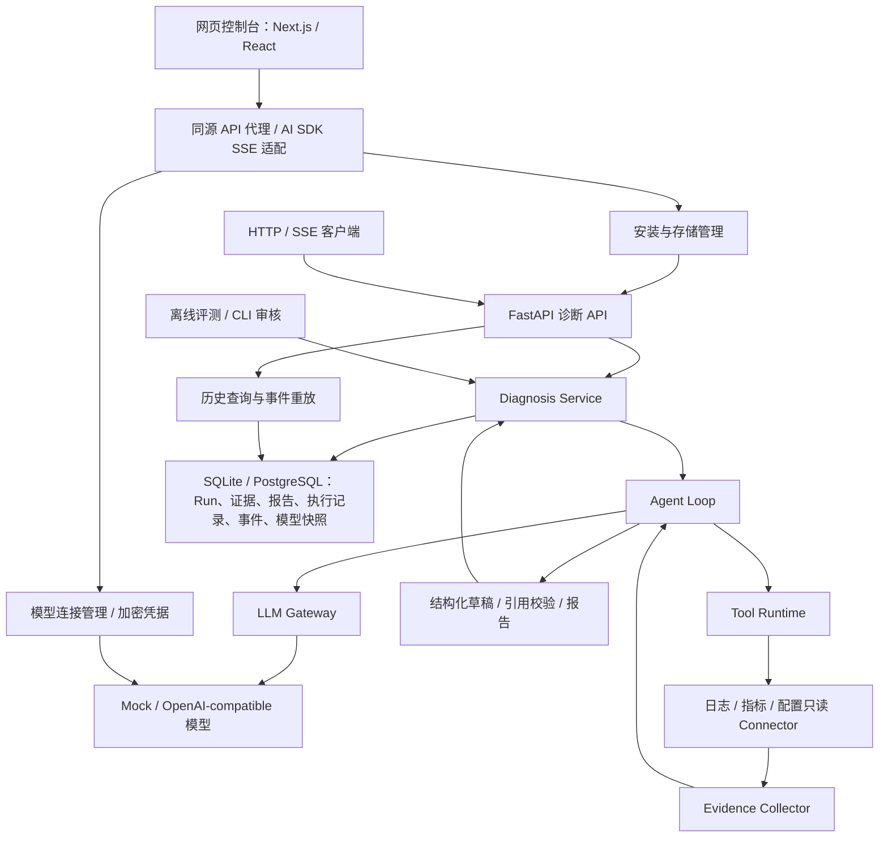

# EvidenceOps

<p align="center"><strong>以证据为依据的软件故障诊断 Agent</strong></p>
<p align="center">
<a href="README.md">English</a> · <a href="#快速启动">本机运行</a> · <a href="#核心能力">核心能力</a> · <a href="#系统架构">系统架构</a> · <a href="#http-api">API 参考</a> · <a href="#测试">测试</a>
</p>

EvidenceOps 是一套本机软件故障诊断工作台。Agent 通过受限的只读工具调查故障，并生成引用本次 Run 证据的报告。网页控制台可查看工具执行、核对证据并回查已持久化的 Run。

**立即体验：**仓库内置确定性的 Mock 模型和 order-service 样例数据。Mock 返回固定演示结论，不会理解故障描述；报告会明确标记为演示。网页可以配置真实的 OpenAI-compatible 模型，但当前仍使用仓库内置样例数据源。

**当前范围：**导入文本只会填入浏览器输入框，不会上传文件或配置客户数据源。可选知识工具对已发布文档进行精确 cosine 检索，为 Agent 提供带独立引用的片段正文快照。客户日志接入和语言专属解析尚未实现。证据引用校验只确认归属和存在，不代表来源在语义上证明了结论。

**安装状态：**目前可用方式是下方的源码安装。仓库中有 Inno Setup 打包配置，但尚未发布经过验证、可下载的 `EvidenceOps-Setup.exe`。

## 核心能力

| 能力 | 行为 |
| --- | --- |
| 诊断编排 | 独立于供应商的 Agent Loop、OpenAI-compatible 适配器、确定性 Mock |
| 受控工具 | 只读注册、参数校验、有界并发与调用关联 |
| 证据报告 | 来源、观测时间、位置、版本、内容哈希与引用校验 |
| 网页控制台 | 诊断工作台、可检索历史、证据抽屉、执行时间线与离线评测查看 |
| 模型连接 | 加密凭据、模型目录、显式能力验证、默认配置与本次诊断选择 |
| 历史归档 | 安装版默认 SQLite，可切换至受管理的 PostgreSQL |
| 安装与存储 | 首次设置、连接检查、存储切换、逻辑备份导入导出与恢复 |
| 流式与重连 | SSE 生命周期事件，按游标补发，不重新执行诊断 |
| 执行控制 | 共享预算、单次超时与协作取消 |
| 启动收尾 | 单实例锁保护；遗留 Run 原子失败并追加终止事件 |
| 质量评测 | 20 案例离线题库、自动规则、可恢复的 CLI 人工审核 |
| 知识组件 | 有界 UTF-8 加载、稳定文档/版本/片段身份、SQLAlchemy 持久化及确定性关键词检索 |
| 检索评测 | Precision、Recall 和倒数排名计算；Embedding 接口及确定性测试供应商 |

## 快速启动

需要 Python 3.14、Node.js 20.9 或更高版本以及 PowerShell 7。以下命令均在仓库根目录执行。只有可选的 PostgreSQL 开发服务需要 Docker Compose；安装版默认使用 SQLite。

### 启动完整应用（推荐）

**使用网页控制台请通过此入口同时启动前后端。** 首次下载后，先在仓库根目录安装依赖并构建前端：

```powershell
python -m venv .venv
.venv/Scripts/python.exe -m pip install -r requirements.txt
cd frontend
npm.cmd ci
npm.cmd run build
cd ..
pwsh -File scripts/start_installed.ps1
```

打开 [EvidenceOps](http://127.0.0.1:3013)。启动脚本运行 8014 安装版 API 与 3013 网页，统一数据目录和服务端管理令牌。全新安装默认使用 SQLite 与 Mock；首次设置检查存储、模型配置，并明确当前数据源为样例。

依赖与构建准备好后，日常启动只需在仓库根目录执行：

```powershell
pwsh -File scripts/start_installed.ps1
```

保持此终端运行。按 `Ctrl+C` 停止前后端；关闭终端后服务不会继续提供网页，也不会自动在开机时启动。再次运行同一命令即可启动，使用同一数据目录时保留已有历史和配置。更新前端源码后，停止服务并重新执行 `npm.cmd ci`、`npm.cmd run build`（在 `frontend` 目录），再启动脚本。

| 服务 | 默认地址 | 用途 |
| --- | --- | --- |
| 网页控制台 | `http://127.0.0.1:3013` | 用户访问入口 |
| 安装版 API | `http://127.0.0.1:8014` | 网页后台及存储管理 |

启动脚本设置网页代理与数据目录，无需额外启动 `npm run start` 或手动修改前端代理地址。下方的单独开发 API 命令仅启动后端，不会启动网页。

### Windows 安装包状态

仓库中包含 `installer/EvidenceOps.iss` Inno Setup 配置，但尚未编译并验证为可交付的客户安装程序。现阶段请按上方源码安装步骤部署。客户安装、数据目录、备份和运行边界见[本机安装与数据存储](CUSTOMER_INSTALLATION.md)。

| 启动问题 | 处理方式 |
| --- | --- |
| 找不到 `pwsh` | 安装 PowerShell 7，并重新打开终端 |
| 找不到 `node` 或 `npm.cmd` | 安装符合要求的 Node.js，并重新打开终端 |
| 提示依赖或前端构建未准备好 | 完成上面的首次安装命令，确认 `npm.cmd run build` 成功 |
| 端口被占用 | 停止原实例，或指定不同的 `-ApiPort` 和 `-WebPort`，访问新的网页端口 |
| 浏览器显示拒绝连接 | 确认启动终端仍在运行；若脚本退出，检查该终端错误信息后重新启动 |

可用 `-DataDirectory D:/EvidenceOpsData -ApiPort 8014 -WebPort 3013` 调整启动参数。当前采用源码安装，没有打包安装程序。迁移与备份细节见[本机安装与数据存储](CUSTOMER_INSTALLATION.md)。

### 单独启动开发 API

开发入口保留显式 memory/PostgreSQL 模式，不提供安装存储管理。`requirements.txt` 固定后端运行依赖，`requirements-dev.txt` 包含测试依赖。

```powershell
.venv/Scripts/python.exe -m pip install -r requirements-dev.txt
$env:PYTHONPATH=(Join-Path $PWD.Path 'src')
$env:EVIDENCEOPS_PROVIDER='mock'
$env:EVIDENCEOPS_PERSISTENCE='memory'
.\.venv\Scripts\python.exe -m uvicorn evidenceops.api.agent_app:app --host 127.0.0.1 --port 8000
```

打开 [API 文档](http://127.0.0.1:8000/docs)。此模式无需数据库或模型凭据；持久化历史与重放不可用。

前端单独开发时，在 `frontend` 执行 `npm ci`，在前端终端将 `EVIDENCEOPS_API_URL` 指向该 API，再执行 `npm run dev`，默认网页端口为 3000。开发存储管理页面需连接安装版 API。代理目标属于服务端配置，不允许浏览器指定任意目标地址。

### 为开发 API 启用 PostgreSQL

切换配置前停止 API。在本地未跟踪的 `.env` 设置 `POSTGRES_PASSWORD=<你的本地密码>`。Compose 读取该文件，Python 读取环境变量。

```powershell
$env:POSTGRES_PASSWORD=((Get-Content .env | Where-Object { $_ -match '^POSTGRES_PASSWORD=' } | Select-Object -First 1) -replace '^POSTGRES_PASSWORD=','')
docker compose up -d postgres
docker compose ps
$env:EVIDENCEOPS_PERSISTENCE='postgres'
.\.venv\Scripts\python.exe -m alembic upgrade head
.\.venv\Scripts\python.exe -m uvicorn evidenceops.api.agent_app:app --host 127.0.0.1 --port 8000
```

等待 PostgreSQL healthy 后迁移。宿主机连接 `127.0.0.1:5433`，容器内监听 `5432`。命名卷在容器替换后保留数据库文件，删除卷会删除数据。初始化后修改密码变量不会更改已有数据库角色密码。开发 API 需显式迁移；安装版自动管理 SQLite 迁移，并在存储页面提供需确认的 PostgreSQL 初始化和升级。

### 配置真实模型

网页中通过**设置 → 模型连接**保存并验证用户连接，再在诊断输入区附近选择。也可在 API 终端配置以下变量并重启，提供只读系统连接：

```powershell
$env:EVIDENCEOPS_PROVIDER='openai-compatible'
$env:EVIDENCEOPS_MODEL_BASE_URL='https://your-provider.example/compatible-mode/v1'
$env:EVIDENCEOPS_MODEL_NAME='your-tool-capable-model'
$model_secret=Read-Host '模型 API Key' -AsSecureString
$env:EVIDENCEOPS_MODEL_API_KEY=[System.Net.NetworkCredential]::new('', $model_secret).Password
Remove-Variable model_secret
$env:EVIDENCEOPS_MODEL_TIMEOUT_SECONDS='120'
$env:EVIDENCEOPS_RUN_TIMEOUT_SECONDS='180'
```

替换为供应商实际地址和模型。适配器使用 Chat Completions 工具调用与 JSON-object 输出；仅声明接口兼容不代表完整支持协议。真实请求产生供应商费用。

## 系统架构



模型提出工具调用，Tool Runtime 校验和执行。应用层管理状态、预算、取消与报告构建；基础设施提供数据库及模型适配器。

### 知识组件

知识层将参考资料与故障观测分开处理。逻辑文档拥有按内容生成身份的版本；同一版本可以有多套绑定切分算法和配置的片段集合。片段保留原文范围、标题路径和内容哈希。本地加载必须明确指定知识用途，只读取配置目录和字节限制内的 UTF-8 Markdown/TXT。

SQLAlchemy 仓储保存文档、不可变版本、切分集合、编码配置和向量。每份文档通过默认发布指针选择 ready 状态的 EmbeddingSet；精确 cosine 检索先过滤候选再评分，并拒绝不兼容编码器。关键词检索和检索指标提供确定性基线。摄取、构建、发布通过内部 CLI 操作，没有知识管理 HTTP 接口或工作台操作入口。

独立的 OpenAI 兼容 Embedding 适配器支持真实编码。显式启用 `search_knowledge` 后，Agent 可检索服务端配置的至多 16 份文档白名单，要求编码配置兼容，只编码一次查询，共享候选预算并统一排序；每个片段在下一轮模型请求前绑定独立 Evidence ID。本次可见正文、哈希、来源版本、片段身份、分数和编码集合身份一起归档，并进入诊断及历史响应，失败 Run 同样保留。零命中不生成 Evidence；检索故障沿用终止诊断的工具失败策略。默认 Mock 场景不会自动调用知识工具。

配置项：`EVIDENCEOPS_KNOWLEDGE_ENABLED=true`、`EVIDENCEOPS_KNOWLEDGE_DOCUMENT_IDS`（逗号分隔，兼容旧单数配置 `EVIDENCEOPS_KNOWLEDGE_DOCUMENT_ID`）、`EMBEDDING_PROVIDER`、`EMBEDDING_ENDPOINT`（完整 HTTPS `/embeddings` 地址）、`EMBEDDING_MODEL`、`EMBEDDING_DIMENSIONS`、`EMBEDDING_API_KEY`（或 `DASHSCOPE_API_KEY`）。可选模型修订和文档/查询前缀必须与已发布编码配置一致。启用前执行 `alembic upgrade head`；诊断模型凭据独立配置。`scripts/verify_knowledge_agent.py` 使用真实 Embedding、PostgreSQL 和确定性生成替身验证引用及失败保留。

练习语料清单位于 `samples/knowledge/manifest.json`，覆盖 RPC 超时、Python 导入、PostgreSQL 连接、SQLAlchemy 连接池、Java 堆内存、Go 数据竞争和 Rust panic。资料为引用官方文档的原创摘要，不能视为现场观测或完整的多语言支持承诺。配置数据库与 Embedding 后执行：

```powershell
python -m evidenceops.application.knowledge_corpus_cli prepare samples/knowledge/manifest.json --publish
python -m evidenceops.application.knowledge_corpus_cli evaluate samples/knowledge/manifest.json
```

发布以单份文档为原子单位，不是整库原子切换；重复构建未变化且已发布的资料会复用编码集合。除文档级基线外，提供片段标注题集和 cosine/RRF 同题对照命令。设置 `EVIDENCEOPS_KNOWLEDGE_RETRIEVAL=hybrid` 可选用词频关键词与向量排名融合，默认仍为 cosine；两路共享发布候选与编码配置。RRF 分数不是余弦相似度，两路分数和排名随检索元数据归档。关键词分支不是 BM25。未设相似度阈值时，无关查询也可能返回 Top-K 片段。

资料不足以支持诊断时，模型可返回独立的 `insufficient_evidence` 结果。系统将其保存为 `failed / EVIDENCE_INSUFFICIENT`，`report=null`，保留已有观测，并通过 `error_detail` 返回不足原因及 `missing_information`。诊断响应、终止 SSE 和历史查询均可读取说明。格式错误仍为 `MODEL_PROTOCOL_ERROR`；正常报告仍须引用有效证据，引用存在不等于语义支持成立。

每次检索最多五个片段、总正文最多 16,000 字符。默认不设相似度阈值，无关问题仍可能返回 Top-K；空结果处理不等于自动识别无答案。资料属于不可信数据，不能证明本次故障因果；引用存在性检查和提示约束不保证语义正确，也不能完全防止提示注入。pgvector/近似索引及重排尚未实现。取消会停止等待并拒绝晚到结果，已经运行的同步 Embedding HTTP 请求不会被强制终止。

| 目录 | 职责 |
| --- | --- |
| `src/evidenceops/domain/` | Run 生命周期、Evidence 与报告约束 |
| `src/evidenceops/application/` | 编排、接口契约、收集、历史查询与启动收尾 |
| `src/evidenceops/infrastructure/` | SQLAlchemy 仓储和模型供应商 |
| `src/evidenceops/connectors/` | 本地只读数据源 |
| `src/evidenceops/api/` | HTTP 接口与 SSE 传输 |
| `src/evidenceops/evaluation/` | 离线检查与审核 CLI |
| `frontend/src/components/` | 诊断、历史、评测、模型连接与存储页面 |
| `frontend/src/lib/`、`frontend/src/app/api/` | 类型契约、Run 状态、SSE 解析与受控同源代理 |
| `scripts/` | 本机服务启动入口 |
| `alembic/`、`tests/`、`samples/` | 迁移、回归测试与可复现样本 |

## 网页控制台

前端采用 Next.js 16 App Router、React 19、TypeScript、AI SDK 6、assistant-ui、Radix Dialog 与 Tailwind CSS 4。五个页面使用石墨色侧栏、中性工作区、紧凑表单，以及对应真实结果的状态色。

| 页面 | 职责 |
| --- | --- |
| 诊断工作台 | 文本输入与本地文本导入、本次模型选择、实时执行时间线、取消、报告与可点击证据引用 |
| 运行历史 | 服务端搜索、状态筛选、分页、Run ID 查询及地址刷新回查 |
| 评测结果 | 本地只读导入 schema_version=1 的 JSON，校验统计并查看规则和人工审核状态 |
| 模型连接 | 添加、编辑、删除、替换凭据、获取目录、显式验证及独立全局默认 |
| 数据与存储 | 首次设置、实际存储状态、数据库检查、维护进度、备份与恢复 |

模型供应商请求由受控后端执行。凭据只在创建或替换时提交，读取接口不返回 API Key；密钥不进入浏览器持久存储、URL 或日志。接口目录、推荐项和手填模型均不代表账号有权限或满足 Agent 要求。验证分别检查认证、模型调用、工具结果关联及结构化报告，可能产生少量供应商费用。

工作台临时选择不改变全局默认。每个 Run 保存连接名称、供应商、请求/实际模型及配置版本；后续修改或删除连接不改写历史。旧 Run 缺少模型信息时显示“未记录”。Embedding 与 Rerank 按用途独立管理，切换诊断模型不会重配这些能力或重建索引。

`POST /api/diagnosis` 将 AI SDK 消息适配为一次后端诊断。取得 Run ID 后，断线按有界退避恢复 GET 观察，不重复创建。事件按 Run ID 与序号去重，拒绝缺口和跨 Run 数据。传输失败与业务失败分别表达；关闭观察连接不取消后台诊断，取消需要显式请求。

证据视图展示已归档的摘要、位置、时间、版本与哈希，不提供原始日志全文。离线评测文件只在浏览器读取，不启动在线评测。接口细节见[模型连接接口契约](frontend/MODEL_CONNECTIONS_CONTRACT.md)。

故障输入由页面、代理及后端进行结构校验：拒绝空白、纯标点、纯符号及超过 100000 字符的描述，允许短错误码和多语言日志。字符校验不能判断语义是否充分。Mock 使用固定工具调用与报告，不理解输入；报告按运行快照显示“Mock 演示报告”和“样例置信度”。目前 Mock 仍可从工作台发起，尚未分离独立演示入口。

### 前端开发与文件职责

| 目录 | 职责 |
| --- | --- |
| `frontend/src/components/` | 工作台、历史、评测、模型连接和存储页面 |
| `frontend/src/lib/` | 类型契约、事件解析、运行状态、证据编号和接口请求 |
| `frontend/src/app/api/diagnosis/` | AI SDK 消息与后端 SSE 的适配 |
| `frontend/src/app/api/backend/` | 固定目标、路由白名单和维护令牌转发 |
| `frontend/src/app/globals.css` | 样式、状态、焦点和响应式布局 |
| `frontend/tests/` | 单元测试、隔离后端与 Playwright CLI 场景 |

单独开发前端时，先按上文启动 FastAPI，再在另一个终端运行：

```powershell
cd frontend
npm.cmd ci
$env:EVIDENCEOPS_API_URL='http://127.0.0.1:8000'
npm.cmd run dev
```

开发网页默认端口为 3000；`npm.cmd run start -- --port 3013` 可指定生产端口。单独启动安装版前后端时，两端必须使用同一 `EVIDENCEOPS_DATA_DIR`，Next.js 服务端从中读取管理令牌。完整应用优先使用根目录启动脚本，避免配置不一致。

## 数据与存储

安装版将程序文件与持久数据分离。Windows 默认目录为 `%LOCALAPPDATA%/EvidenceOps`，其他平台使用 `$XDG_DATA_HOME/evidenceops` 或 `~/.local/share/evidenceops`。目录在实际运行主机上解析，可通过 `EVIDENCEOPS_DATA_DIR` 覆盖。

Run、报告、证据摘要、执行记录、事件和模型快照保存到所选诊断数据库；模型连接使用独立加密配置库。SQLite 无需外部数据库服务。PostgreSQL 使用管理员准备的专用数据库和账号，程序不安装数据库服务器或创建数据库角色。

存储维护等待已有诊断和模型验证结束，同时拒绝新诊断。切换前备份，向空目标导入并校验后发布新配置。数据库故障时管理页面仍可访问，诊断暂停，不自动降级到内存模式。

安装入口从迁移链读取当前结构版本，拒绝未知或多头版本；知识能力按实际工具注册及存储就绪状态声明。逻辑备份保存知识版本、片段、编码集合、向量、发布指针和Run正文快照，按原版本验证后转换旧档案，不伪造缺失正文。

逻辑备份支持创建、下载、导入和恢复，上限 100 MB。恢复需明确确认，并保留 Run 身份与引用关系；SQLite 使用新文件，PostgreSQL 要求目标为空。默认不包含 API Key；携带可迁移凭据需至少 12 字符的独立口令，由目标账号重新保护，恢复后的模型连接需要验证。仅复制 Windows DPAPI 密钥文件不能保证另一用户可以解密。

## 配置

| 环境变量 | 默认值 | 用途 |
| --- | --- | --- |
| `EVIDENCEOPS_PROVIDER` | `mock` | `mock` 或 `openai-compatible` |
| `EVIDENCEOPS_PERSISTENCE` | 开发入口 `memory`；全新安装 SQLite | 开发入口 `memory`/`postgres`；安装版管理所选存储 |
| `EVIDENCEOPS_API_URL` | `http://127.0.0.1:8000` | Next.js 服务端代理目标，启动脚本设置 API 端口 |
| `EVIDENCEOPS_DATA_DIR` | 平台数据目录 | 安装版数据与管理令牌目录 |
| `EVIDENCEOPS_ADMIN_TOKEN_FILE` | `<数据目录>/admin.token` | 可选的 Next.js 管理令牌文件覆盖 |
| `EVIDENCEOPS_CONNECTIONS_DIR` | 安装版 `<数据目录>/model-connections`；开发入口 `output/model-connections` | 加密模型连接库 |
| `EVIDENCEOPS_CONNECTIONS_KEY` | 本机生成并保护 | 可选的外部 Fernet 密钥 |
| `EVIDENCEOPS_MODEL_ALLOWED_HOSTS` | `maas.qianwenaiapi.com,dashscope.aliyuncs.com` | 供应商主机白名单，包含自定义服务 |
| `EVIDENCEOPS_MODEL_ALLOW_HTTP` | 禁用 | 管理员显式允许 HTTP 模型接口 |
| `EVIDENCEOPS_MODEL_BASE_URL` | — | 模型基础地址 |
| `EVIDENCEOPS_MODEL_API_KEY` | — | 模型凭据 |
| `EVIDENCEOPS_MODEL_NAME` | — | 模型名称 |
| `EVIDENCEOPS_MODEL_TIMEOUT_SECONDS` | `60` | 真实模型单次超时 |
| `EVIDENCEOPS_RUN_TIMEOUT_SECONDS` | `180` | API 诊断预算 |
| `POSTGRES_HOST` / `POSTGRES_PORT` | `127.0.0.1` / `5433` | 宿主机数据库地址 |
| `POSTGRES_DB` / `POSTGRES_USER` | `evidenceops` / `evidenceops` | 数据库及角色 |
| `POSTGRES_PASSWORD` | — | PostgreSQL 模式必填 |

修改环境变量后重启。直接使用组装器或离线 Eval 不自动启用 API 的预算。

## HTTP API

| 方法 | 接口 | 用途 |
| --- | --- | --- |
| POST | `/api/v1/agent/diagnosis` | 创建诊断，返回结果 |
| POST | `/api/v1/agent/diagnosis/stream` | 创建诊断，推送过程 |
| GET | `/api/v1/agent/runs/{run_id}` | 查询持久化状态与档案 |
| GET | `/api/v1/agent/runs/{run_id}/events` | 分页读取有序事件 |
| GET | `/api/v1/agent/runs/{run_id}/events/stream` | 补发并观察已有 Run |
| POST | `/api/v1/agent/runs/{run_id}/cancel` | 请求取消 |
| GET | `/api/v1/agent/capabilities` | 查询实际服务能力 |
| GET | `/api/v1/agent/runs` | 搜索、筛选和分页查询归档 Run |
| GET | `/api/v1/agent/model-services` | 查询支持的服务预设 |
| GET / POST | `/api/v1/agent/model-connections` | 查询或创建模型连接 |
| GET / PATCH / DELETE | `/api/v1/agent/model-connections/{id}` | 读取、编辑或删除连接 |
| PUT | `/api/v1/agent/model-connections/default` | 设置全局默认连接和模型 |
| POST | `/api/v1/agent/model-connections/{id}/catalog` | 获取模型目录 |
| POST | `/api/v1/agent/model-connections/{id}/validation` | 验证连接和模型能力 |
| GET | `/api/v1/agent/setup/status`、`/api/v1/agent/storage/status` | 安装设置与存储状态 |
| POST | `/api/v1/agent/storage/check` | 检查目标数据库连接 |
| POST / GET | `/api/v1/agent/storage/operations`、`/api/v1/agent/storage/operations/{id}` | 发起维护、读取进度 |
| GET / POST | `/api/v1/agent/storage/backups/{id}`、`/api/v1/agent/storage/backups/import` | 下载、导入逻辑备份 |

在另一个终端发送样本：

```powershell
curl.exe -N -X POST "http://127.0.0.1:8000/api/v1/agent/diagnosis/stream" -H "Content-Type: application/json" --data-binary "@samples/requests/sse-diagnosis.json"
```

诊断请求接收 `description`，可选 `connection_id`、`model_id` 和 `expected_version`。结果包含 ID、状态、时间戳、错误码、Evidence、报告、执行记录与可空的 `model_config`。同步诊断失败目前返回 HTTP 503；历史查询可以返回 HTTP 200 和 `status=failed`。HTTP 请求成功与诊断成功是两个维度。设置与存储接口要求安装版入口，维护写入使用服务端管理令牌。

SSE 发布 Run、模型和工具生命周期事件、可选取消请求，以及 `run_completed`、`run_failed` 或 `run_cancelled` 终止事件。推送的是执行过程，不是模型逐 Token 输出。

```powershell
$run_id=(Read-Host 'Run ID').Trim()
curl.exe "http://127.0.0.1:8000/api/v1/agent/runs/$run_id"
curl.exe "http://127.0.0.1:8000/api/v1/agent/runs/$run_id/events?after=0&limit=100"
curl.exe -N "http://127.0.0.1:8000/api/v1/agent/runs/$run_id/events/stream?after=2"
curl.exe -i -X POST "http://127.0.0.1:8000/api/v1/agent/runs/$run_id/cancel"
```

重放从游标之后开始，也可传 `Last-Event-ID: <run_id>:2`；两种游标同时提供必须一致。分页字段为 `events`、`next_sequence`、`max_sequence`、`has_more` 和 `status`，分页大小为 1～1000。GET 不创建诊断。客户端保存完整事件 ID 并去重；浏览器 EventSource 收到终止事件后应关闭。

取消 HTTP 202 表示接纳请求，不代表终态已提交。重复请求幂等，终态认领冲突返回 409。取消后的 Run 为 `status=cancelled`、`error_code=null`，报告为空。

## 可靠性与运行边界

- **持久化：** 业务事件提交后发送，最终 Run、业务档案和终止事件原子提交。传输失败不撤销提交；仅传输故障的 `stream_failed` 不带持久化 SSE ID。
- **重放：** 历史与新事件共用数据库游标。短 Session 在发送/等待前关闭，0.5 秒轮询，15 秒心跳。
- **容量：** 每进程 4 个 POST 流式诊断、16 个 GET 观察连接，分别限流；这不是同步 POST 的全局并发上限。
- **执行控制：** 协作检查拒绝迟到结果。提交、清理和非协作线程可能超过预算。本地取消模型不保证上游停止生成或计费。
- **启动收尾：** PostgreSQL 使用会话锁，安装版 SQLite 使用本机文件锁。遗留 `pending/running` 原子改为 `failed / RUN_INTERRUPTED` 并追加终止事件；重复启动幂等，不续跑 Agent。
- **崩溃边界：** 已提交档案保留。完整 Evidence 和执行记录主要在收尾归档，因此可能事件已保存而对应业务档案仍缺失。
- **部署范围：** 本机、单租户、单 worker，启用 lifespan。远程登录、多用户权限、分布式协调、自动保留/备份和客户数据源配置未实现。启动脚本监督子进程，停止脚本会终止这些进程；长期服务安装需另行配置进程管理与关停策略。

历史/重放要求持久存储：安装版 SQLite 或 PostgreSQL；开发入口内存模式不提供历史。常见重放错误：`RUN_NOT_FOUND`（404）、游标格式/冲突（422）、`INVALID_EVENT_CURSOR` 或 `EVENT_HISTORY_GAP`（409）、`REPLAY_BUSY`（429）。模型协议失败和工具拒绝仍返回明确诊断结果。

## 评测

20 案例复用诊断运行时，不依赖 HTTP/PostgreSQL。自动规则检查工具参数、预期结果、证据和引用，CLI 审核检查报告语义。

```powershell
.\.venv\Scripts\python.exe -X utf8 -m evidenceops.evaluation --mode mock --output eval_result_mock.json
.\.venv\Scripts\python.exe -X utf8 -m evidenceops.evaluation review eval_result_mock.json
```

配置模型变量后，使用 `--mode real` 评测真实模型。审核输入 y/n 及可选评论，每条保存，重启后继续待审案例。

| 指标 | 定义 |
| --- | --- |
| `rule_pass_rate` | 规则通过数 / 全部案例 |
| `semantic_pass_rate` | 人工通过数 / 全部案例 |
| `final_pass_rate` | 两者均通过数 / 全部案例 |

待审核和执行异常保留在分母。按预期拒绝非法请求也可以评测通过。Mock 验证工程行为，不能代表真实模型准确率。

## 测试

```powershell
.venv/Scripts/python.exe -m pip install -r requirements-dev.txt
$env:PYTHONPATH=(Join-Path $PWD.Path 'src')
.\.venv\Scripts\python.exe -X utf8 -m pytest -q -p no:cacheprovider
```

覆盖领域规则、工具、模型、持久化、评测、流式、预算、取消、重放和启动收尾。PostgreSQL 测试需显式启用：配置数据库变量，pytest 前设置 `EVIDENCEOPS_TEST_POSTGRES='1'`，结束后移除。实验使用隔离 schema 和测试锁键。真实模型验收与确定性回归分开执行。

前端检查：

```powershell
cd frontend
npm test
npm run typecheck
npm run build
```

Playwright CLI 场景覆盖诊断、取消、重连、历史、证据、模型管理、安装、备份恢复、故障、文件竞态、键盘交互及 320～1440 像素布局。测试需隔离的 3011/8011 和 3015/8015 服务、确定性模型，以及首次设置用的全新安装目录。写入与恢复场景不能指向客户数据。[测试报告](frontend/FRONTEND_TEST_REPORT.md)保留具体日期的验证证据及边界。

`frontend/tests/serve_backend.py` 提供隔离后端工厂；`EVIDENCEOPS_BROWSER_TEST_ROOT` 指定全新测试目录。普通场景使用网页 3011 / API 8011；安装场景使用网页 3015 / API 8015，并让两端使用同一全新数据目录。安装场景以 `create_installed_app` 配合 `build_test_app` 工厂启动。测试模型不请求供应商，故障和延迟仅在测试供应商中注入。

准备上述服务后，在根目录执行：

```powershell
npx.cmd --yes --package @playwright/cli playwright-cli -s=evidenceops open http://127.0.0.1:3011 --browser msedge
.venv/Scripts/python.exe frontend/tests/run_browser_audit.py
```

首次设置场景需要尚未初始化的目录。可回归指定组，如 `run_browser_audit.py failures audit-regressions`。结果、日志、截图和隔离数据库写入已忽略的 `output/playwright/`。

## 贡献约定

领域规则与模型/数据库适配器及前端传输层分离。修改附带相关失败路径测试，并同步中英文接口与配置说明。不提交凭据、本机数据库或生成的评测结果。Python 依赖清单固定直接依赖，前端安装使用 `package-lock.json`；仓库当前未声明许可证。
