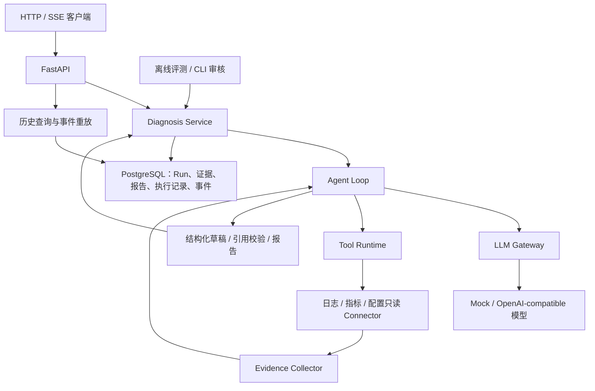

# EvidenceOps

<p align="center"><strong>以证据为依据的软件故障诊断 Agent</strong></p>
<p align="center">
<a href="README.md">English</a> · <a href="#快速启动">快速启动</a> · <a href="#系统架构">系统架构</a> · <a href="#http-api">API</a> · <a href="#评测">评测</a>
</p>

EvidenceOps 是一个后端诊断 Agent，将模型推理与受控的只读证据查询结合。结构化报告引用同一 Run 的证据，执行记录与持久化过程事件支持回查和重放。

产品面向常见编程语言及后端技术栈的软件故障。当前 API 接收诊断描述，查询本地 JSONL 日志、指标与历史配置。文件上传、语言专属自动解析及 RAG 检索尚未实现。仓库中的 order-service RPC 场景是可复现示例，不是产品的用户范围限制。

## 核心能力

| 能力 | 行为 |
| --- | --- |
| 诊断编排 | 独立于供应商的 Agent Loop、OpenAI-compatible 适配器、确定性 Mock |
| 受控工具 | 只读注册、参数校验、有界并发与调用关联 |
| 证据报告 | 来源、观测时间、位置、版本、内容哈希与引用校验 |
| 历史归档 | PostgreSQL 保存 Run、Evidence、报告、执行记录与事件 |
| 流式与重连 | SSE 生命周期事件，按游标补发，不重新执行诊断 |
| 执行控制 | 共享预算、单次超时与协作取消 |
| 启动收尾 | 单实例锁保护；遗留 Run 原子失败并追加终止事件 |
| 质量评测 | 20 案例离线题库、自动规则、可恢复的 CLI 人工审核 |

引用校验确认 Evidence 存在且属于本次诊断，不自动证明证据语义支持结论；报告语义质量通过独立评测检查。

## 系统架构



模型提出工具调用，Tool Runtime 校验和执行。应用层管理状态、预算、取消与报告构建；基础设施提供数据库及模型适配器。

| 目录 | 职责 |
| --- | --- |
| `src/evidenceops/domain/` | Run 生命周期、Evidence 与报告约束 |
| `src/evidenceops/application/` | 编排、接口契约、收集、历史查询与启动收尾 |
| `src/evidenceops/infrastructure/` | SQLAlchemy 仓储和模型供应商 |
| `src/evidenceops/connectors/` | 本地只读数据源 |
| `src/evidenceops/api/` | HTTP 接口与 SSE 传输 |
| `src/evidenceops/evaluation/` | 离线检查与审核 CLI |
| `alembic/`、`tests/`、`samples/` | 迁移、回归测试与可复现样本 |

## 快速启动

需要 Python 3.14 和 PowerShell。PostgreSQL 模式还需要 Docker Compose。以下命令均在仓库根目录执行。API 运行在宿主机，Compose 仅运行 PostgreSQL。

### 安装并本地启动

当前仓库尚无依赖清单或锁文件，运行及测试依赖显式安装：

```powershell
python -m venv .venv
.\.venv\Scripts\python.exe -m pip install fastapi uvicorn httpx pydantic sqlalchemy alembic "psycopg[binary]" pytest
$env:PYTHONPATH=(Join-Path $PWD.Path 'src')
$env:EVIDENCEOPS_PROVIDER='mock'
$env:EVIDENCEOPS_PERSISTENCE='memory'
.\.venv\Scripts\python.exe -m uvicorn evidenceops.api.agent_app:app --host 127.0.0.1 --port 8000
```

打开 [API 文档](http://127.0.0.1:8000/docs)。此模式无需数据库或模型凭据；持久化历史与重放不可用。

### 启用 PostgreSQL

切换配置前停止 API。在本地未跟踪的 `.env` 设置 `POSTGRES_PASSWORD=<你的本地密码>`。Compose 读取该文件，Python 读取环境变量。

```powershell
$env:POSTGRES_PASSWORD=((Get-Content .env | Where-Object { $_ -match '^POSTGRES_PASSWORD=' } | Select-Object -First 1) -replace '^POSTGRES_PASSWORD=','')
docker compose up -d postgres
docker compose ps
$env:EVIDENCEOPS_PERSISTENCE='postgres'
.\.venv\Scripts\python.exe -m alembic upgrade head
.\.venv\Scripts\python.exe -m uvicorn evidenceops.api.agent_app:app --host 127.0.0.1 --port 8000
```

等待 PostgreSQL healthy 后迁移。宿主机连接 `127.0.0.1:5433`，容器内监听 `5432`。命名卷在容器替换后保留数据库文件，删除卷会删除数据。初始化后修改密码变量不会更改已有数据库角色密码。迁移需显式执行，API 启动不自动迁移。

### 配置真实模型

在 API 终端设置变量，再重新启动服务：

```powershell
$env:EVIDENCEOPS_PROVIDER='openai-compatible'
$env:EVIDENCEOPS_MODEL_BASE_URL='https://your-provider.example/compatible-mode/v1'
$env:EVIDENCEOPS_MODEL_NAME='your-tool-capable-model'
$model_secret=Read-Host '模型 API Key' -AsSecureString
$env:EVIDENCEOPS_MODEL_API_KEY=[System.Net.NetworkCredential]::new('', $model_secret).Password
Remove-Variable model_secret
$env:EVIDENCEOPS_MODEL_TIMEOUT_SECONDS='120'
$env:EVIDENCEOPS_RUN_TIMEOUT_SECONDS='180'
```

替换为供应商实际地址和模型。适配器使用 Chat Completions 工具调用与 JSON-object 输出；仅声明接口兼容不代表完整支持协议。真实请求产生供应商费用。

## 配置

| 环境变量 | 默认值 | 用途 |
| --- | --- | --- |
| `EVIDENCEOPS_PROVIDER` | `mock` | `mock` 或 `openai-compatible` |
| `EVIDENCEOPS_PERSISTENCE` | `memory` | `memory` 或 `postgres` |
| `EVIDENCEOPS_MODEL_BASE_URL` | — | 模型基础地址 |
| `EVIDENCEOPS_MODEL_API_KEY` | — | 模型凭据 |
| `EVIDENCEOPS_MODEL_NAME` | — | 模型名称 |
| `EVIDENCEOPS_MODEL_TIMEOUT_SECONDS` | `60` | 真实模型单次超时 |
| `EVIDENCEOPS_RUN_TIMEOUT_SECONDS` | `180` | API 诊断预算 |
| `POSTGRES_HOST` / `POSTGRES_PORT` | `127.0.0.1` / `5433` | 宿主机数据库地址 |
| `POSTGRES_DB` / `POSTGRES_USER` | `evidenceops` / `evidenceops` | 数据库及角色 |
| `POSTGRES_PASSWORD` | — | PostgreSQL 模式必填 |

修改环境变量后重启。直接使用组装器或离线 Eval 不自动启用 API 的预算。

## HTTP API

| 方法 | 接口 | 用途 |
| --- | --- | --- |
| POST | `/api/v1/agent/diagnosis` | 创建诊断，返回结果 |
| POST | `/api/v1/agent/diagnosis/stream` | 创建诊断，推送过程 |
| GET | `/api/v1/agent/runs/{run_id}` | 查询持久化状态与档案 |
| GET | `/api/v1/agent/runs/{run_id}/events` | 分页读取有序事件 |
| GET | `/api/v1/agent/runs/{run_id}/events/stream` | 补发并观察已有 Run |
| POST | `/api/v1/agent/runs/{run_id}/cancel` | 请求取消 |

在另一个终端发送样本：

```powershell
curl.exe -N -X POST "http://127.0.0.1:8000/api/v1/agent/diagnosis/stream" -H "Content-Type: application/json" --data-binary "@samples/requests/sse-diagnosis.json"
```

结果包含 ID、状态、时间戳、错误码、Evidence、报告与执行记录。同步诊断失败目前返回 HTTP 503；历史查询可以返回 HTTP 200 和 `status=failed`。HTTP 请求成功与诊断成功是两个维度。

SSE 发布 Run、模型和工具生命周期事件、可选取消请求，以及 `run_completed`、`run_failed` 或 `run_cancelled` 终止事件。推送的是执行过程，不是模型逐 Token 输出。

```powershell
$run_id=(Read-Host 'Run ID').Trim()
curl.exe "http://127.0.0.1:8000/api/v1/agent/runs/$run_id"
curl.exe "http://127.0.0.1:8000/api/v1/agent/runs/$run_id/events?after=0&limit=100"
curl.exe -N "http://127.0.0.1:8000/api/v1/agent/runs/$run_id/events/stream?after=2"
curl.exe -i -X POST "http://127.0.0.1:8000/api/v1/agent/runs/$run_id/cancel"
```

重放从游标之后开始，也可传 `Last-Event-ID: <run_id>:2`；两种游标同时提供必须一致。分页字段为 `events`、`next_sequence`、`max_sequence`、`has_more` 和 `status`，分页大小为 1～1000。GET 不创建诊断。客户端保存完整事件 ID 并去重；浏览器 EventSource 收到终止事件后应关闭。

取消 HTTP 202 表示接纳请求，不代表终态已提交。重复请求幂等，终态认领冲突返回 409。取消后的 Run 为 `status=cancelled`、`error_code=null`，报告为空。

## 可靠性与运行边界

- **持久化：** 业务事件提交后发送，最终 Run、业务档案和终止事件原子提交。传输失败不撤销提交；仅传输故障的 `stream_failed` 不带持久化 SSE ID。
- **重放：** 历史与新事件共用数据库游标。短 Session 在发送/等待前关闭，0.5 秒轮询，15 秒心跳。
- **容量：** 每进程 4 个 POST 流式诊断、16 个 GET 观察连接，分别限流；这不是同步 POST 的全局并发上限。
- **执行控制：** 协作检查拒绝迟到结果。提交、清理和非协作线程可能超过预算。本地取消模型不保证上游停止生成或计费。
- **启动收尾：** PostgreSQL 会话锁限制同一数据库一个 API 实例，遗留 `pending/running` 原子改为 `failed / RUN_INTERRUPTED` 并追加终止事件；重复启动幂等，不续跑 Agent。
- **崩溃边界：** 已提交档案保留。完整 Evidence 和执行记录主要在收尾归档，因此可能事件已保存而对应业务档案仍缺失。
- **部署范围：** 单 worker，启用 lifespan。认证、租户隔离、分布式协调、事件清理、自动备份及生产日志平台 Connector 未实现。当前提供诊断后端基础，不是完整生产运维平台。

历史/重放要求 PostgreSQL。常见重放错误：`RUN_NOT_FOUND`（404）、游标格式/冲突（422）、`INVALID_EVENT_CURSOR` 或 `EVENT_HISTORY_GAP`（409）、`REPLAY_BUSY`（429）。模型协议失败和工具拒绝仍返回明确诊断结果。

## 评测

20 案例复用诊断运行时，不依赖 HTTP/PostgreSQL。自动规则检查工具参数、预期结果、证据和引用，CLI 审核检查报告语义。

```powershell
.\.venv\Scripts\python.exe -X utf8 -m evidenceops.evaluation --mode mock --output eval_result_mock.json
.\.venv\Scripts\python.exe -X utf8 -m evidenceops.evaluation review eval_result_mock.json
```

配置模型变量后，使用 `--mode real` 评测真实模型。审核输入 y/n 及可选评论，每条保存，重启后继续待审案例。

| 指标 | 定义 |
| --- | --- |
| `rule_pass_rate` | 规则通过数 / 全部案例 |
| `semantic_pass_rate` | 人工通过数 / 全部案例 |
| `final_pass_rate` | 两者均通过数 / 全部案例 |

待审核和执行异常保留在分母。按预期拒绝非法请求也可以评测通过。Mock 验证工程行为，不能代表真实模型准确率。

## 测试

```powershell
$env:PYTHONPATH=(Join-Path $PWD.Path 'src')
.\.venv\Scripts\python.exe -X utf8 -m pytest -q -p no:cacheprovider
```

覆盖领域规则、工具、模型、持久化、评测、流式、预算、取消、重放和启动收尾。PostgreSQL 测试需显式启用：配置数据库变量，pytest 前设置 `EVIDENCEOPS_TEST_POSTGRES='1'`，结束后移除。实验使用隔离 schema 和测试锁键。真实模型验收与确定性回归分开执行。

## 扩展方向

计划增加 RAG 摄取/检索、语言/框架输入适配，以及经过评测的 LangChain、LangGraph、MCP 和 OpenTelemetry 集成。这些不是当前依赖或已实现能力。

## 贡献约定

领域规则与模型/数据库适配器分离。修改附带相关失败路径测试及对应接口、配置说明。不提交凭据或生成的评测结果。依赖版本固定与许可证选择仍待完善，仓库当前未声明许可证。
